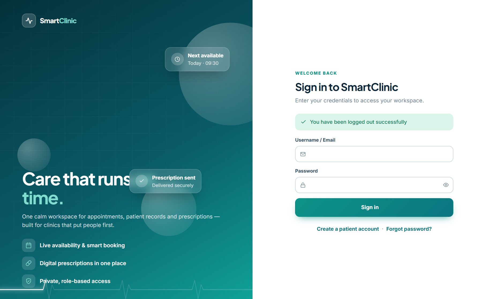
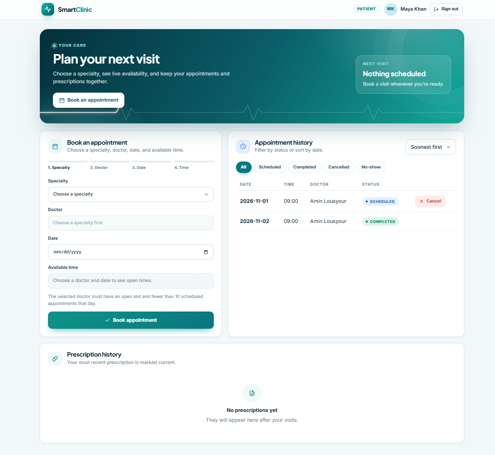
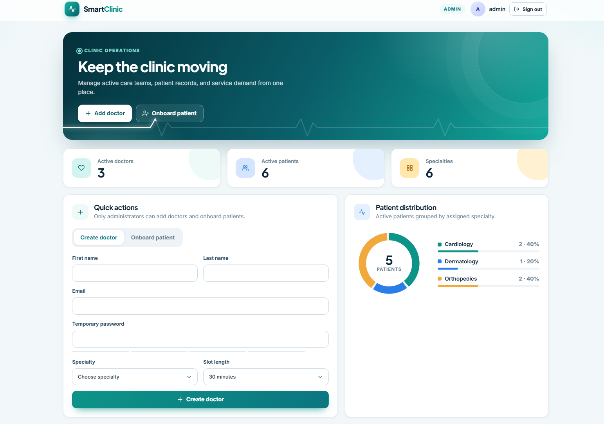
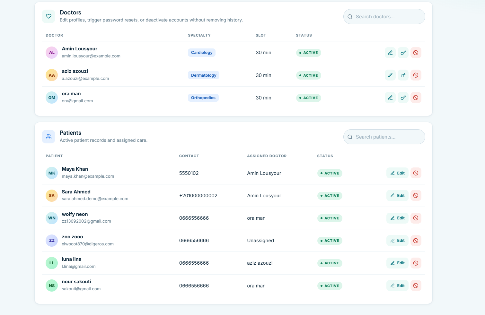
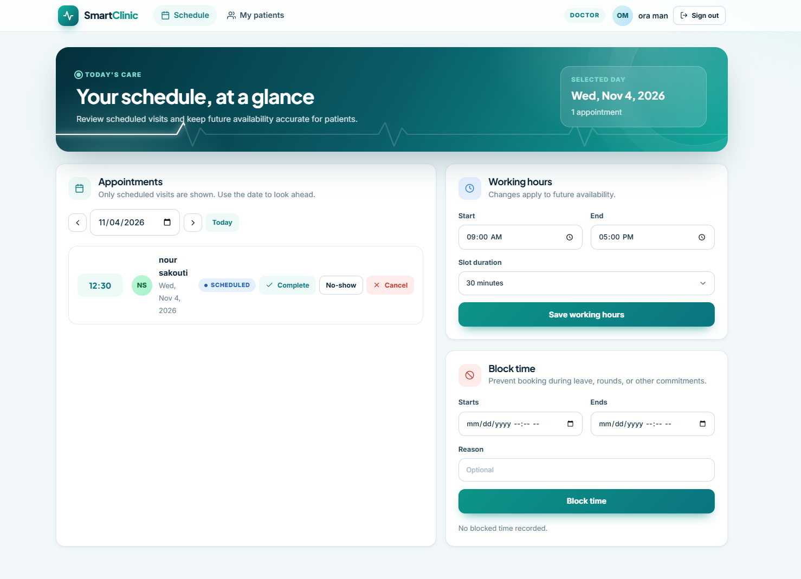
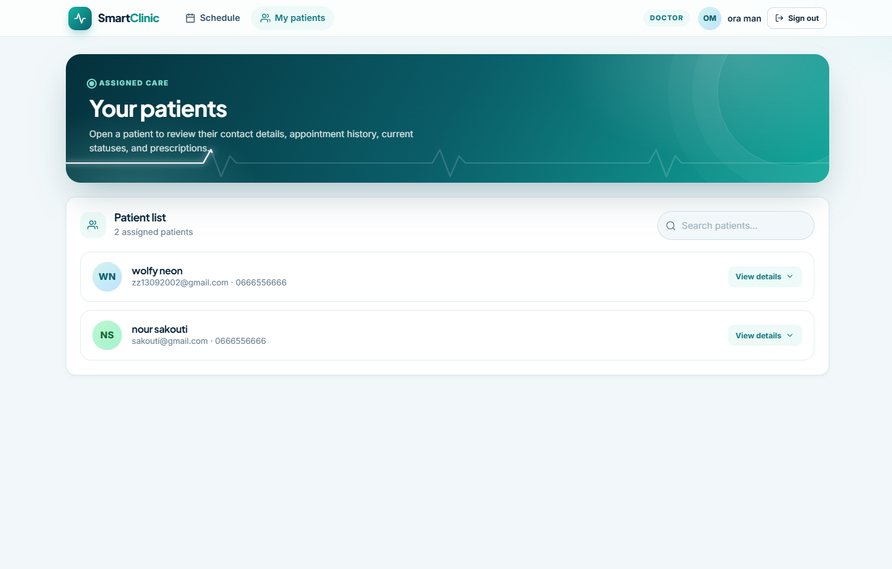

# Smart Clinic Management System

A clinic management application built with Spring Boot, MySQL, and MongoDB.
Provides role-based dashboards for Admin, Doctor, and Patient users.

## Tech Stack

- **Backend:** Spring Boot 4.1.2, Java 17
- **Web:** Spring MVC (Thymeleaf + REST controllers)
- **Security:** Spring Security (form login, BCrypt, role-based authorization)
- **Relational DB:** MySQL (Spring Data JPA) — Admin, Doctor, Patient, Appointment, Specialty
- **Document DB:** MongoDB (Spring Data MongoDB) — Prescriptions
- **Email:** Spring Mail (appointment cancellation notices, password reset)
- **Build:** Apache Maven
- **Templates:** Thymeleaf

## Features (Working)

### Authentication
- Role-based login (Admin / Doctor / Patient)
- Session-based authentication with logout
- Password change (self-service for Doctor/Patient)
- Password reset (patient self-service via email link; admin-triggered for Doctor)

### Admin
- Create, update, deactivate Doctor accounts
- Create, update, deactivate Patient records
- Assign/reassign Patient to a Doctor
- View clinic overview (doctors + patients)

### Doctor
- Set working hours and slot duration
- View today's scheduled appointments
- Mark appointments COMPLETED / NO_SHOW
- Cancel appointments (patient notified by email)
- Create prescriptions (stored in MongoDB)
- View patient prescription history (only for assigned patients)
- Edit/delete own prescriptions only (append-only clinical ledger)

### Patient
- Book appointment (select department, auto-assign doctor)
- Double-booking prevention (doctor + patient level)
- Cancel own appointment
- View appointment list (all statuses)
- View prescription history (most recent marked "Current")

## Screenshots

The following screenshots show the main application screens:

### Login



### Patient Dashboard



### Admin Dashboard




### Doctor Dashboard — Schedule



### Doctor Dashboard — Working Hours and Blocked Time


## Run with Docker (recommended)

### Prerequisites

- Docker Desktop installed and running
- A copy of `.env.example` named `.env` beside `docker-compose.yml`
- SMTP credentials in `.env` if password-reset or email notifications are needed

From the directory containing `docker-compose.yml`:

```powershell
cd SmartClinic\SmartClinic
Copy-Item .env.example .env
# Edit .env and set secure passwords and SMTP values
docker compose up -d --build
docker compose ps
```

Open [http://localhost:8080/login](http://localhost:8080/login).

The Compose stack starts:

- SmartClinic at `localhost:8080`
- MySQL at `localhost:3307`
- MongoDB at `localhost:27017`

Useful commands:

```powershell
docker compose logs -f app
docker compose down
# Also remove database volumes (destructive):
docker compose down -v
```

The active container build is [`Dockerfile`](Dockerfile), which
`docker-compose.yml` uses directly.

## Run Locally

### Prerequisites
- Java 17
- MySQL 8.0+ (database: `smartclinic`)
- MongoDB 5.0+ (database: `smartclinic`)
- SMTP server for email (optional for MVP)

### Configuration

Use environment variables where possible. For a local run, copy `.env.example`
to `.env` and edit it. The application reads local database defaults from
`src/main/resources/application.properties`.

```properties
spring.datasource.url=jdbc:mysql://localhost:3306/smartclinic
spring.datasource.username=smartclinic
spring.datasource.password=your-password
spring.data.mongodb.uri=mongodb://localhost:27017/smartclinic
admin.password=change-me-in-production
spring.mail.username=your-smtp-user
spring.mail.password=your-smtp-app-password
```

### Build and Run

Maven is required to build. The `mvnw` wrapper is included but requires network access to download Maven.

```bash
# Using Maven directly
mvn clean compile
mvn spring-boot:run

# Or using the wrapper (downloads Maven automatically)
./mvnw spring-boot:run
```

The application starts on port 8080 (configurable via `server.port`).

### Default Admin Account

The seeded admin username is `admin` unless overridden with `ADMIN_USERNAME`.
Set a secure `ADMIN_PASSWORD` in `.env`; the application will not start without
an explicit admin password.

## Project Structure

```
src/main/java/org/shopwave/smartclinic/
  admin/          - Admin service
  appointment/    - Appointment service, controller, DTOs
  auth/           - Auth controller, DTOs, password reset service
  config/         - DataLoader (seed data)
  dto/            - Request/response DTOs (all domains)
  doctor/         - Doctor service, controller, DTOs
  email/          - Email service
  patient/        - Patient service, controller, DTOs
  prescription/   - Prescription service, controller, DTOs (MongoDB)
  repository/     - JPA + MongoDB repositories
  security/       - Spring Security config, user details
  specialty/      - Specialty service, controller, DTOs
  web/            - Dashboard controllers, global exception handler
  model/          - JPA entities + MongoDB document
```

## API Summary

### Authentication
- `GET /login` — login page
- `POST /perform-login` — form login (Spring Security)
- `POST /perform-logout` — logout
- `GET /role-redirect` — redirect to role dashboard

### Password Management
- `POST /api/auth/change-password` — self-service password change
- `POST /api/auth/forgot-password` — request reset link (patient)
- `POST /api/auth/reset-password` — confirm reset with token (patient)
- `POST /api/auth/doctor-reset` — admin-triggered doctor reset

### Specialties
- `GET /api/specialties` — list all
- `POST /api/specialties` — create (Admin)
- `PUT /api/specialties/{id}` — update (Admin)
- `DELETE /api/specialties/{id}` — delete (Admin)

### Doctors
- `GET /api/doctors` — list active
- `GET /api/patients/doctor/{doctorId}` — list the doctor's assigned active patients
- `POST /api/doctors` — create (Admin)
- `PUT /api/doctors/{id}` — update (Admin)
- `DELETE /api/doctors/{id}` — deactivate (Admin)
- `PUT /api/doctors/{id}/working-hours` — set hours (Doctor)

### Patients
- `GET /api/patients` — list active
- `POST /api/patients` — create (Admin)
- `PUT /api/patients/{id}` — update (Admin)
- `DELETE /api/patients/{id}` — deactivate (Admin)

### Appointments
- `POST /api/appointments` — book (Patient)
- `GET /api/appointments/patient/{id}` — patient's appointments
- `GET /api/appointments/doctor/{id}/today` — doctor's schedule
- `PUT /api/appointments/{id}/complete` — mark completed (Doctor)
- `PUT /api/appointments/{id}/no-show` — mark no-show (Doctor)
- `PUT /api/appointments/{id}/cancel` — cancel

### Prescriptions
- `POST /api/prescriptions` — create (Doctor)
- `GET /api/prescriptions/patient/{id}` — patient's history
- `GET /api/prescriptions/doctor/{id}` — doctor's prescriptions
- `PUT /api/prescriptions/{id}` — update (Doctor, own only)
- `DELETE /api/prescriptions/{id}` — delete (Doctor, own only)

Doctor dashboard views:
- `/doctor/dashboard` — schedule, working hours, blocked time, and appointment actions
- `/doctor/patients` — assigned patient list with patient details, appointment history, and prescription history

## Project Documentation

- [schema-architecture.md](schema-architecture.md) — application architecture
- [schema-design.md](schema-design.md) — MySQL and MongoDB design
- [user_stories.md](user_stories.md) — role requirements and acceptance criteria
- [docs/04-security-checklist.md](docs/04-security-checklist.md) — security checklist

## License

Internal clinic management system.
